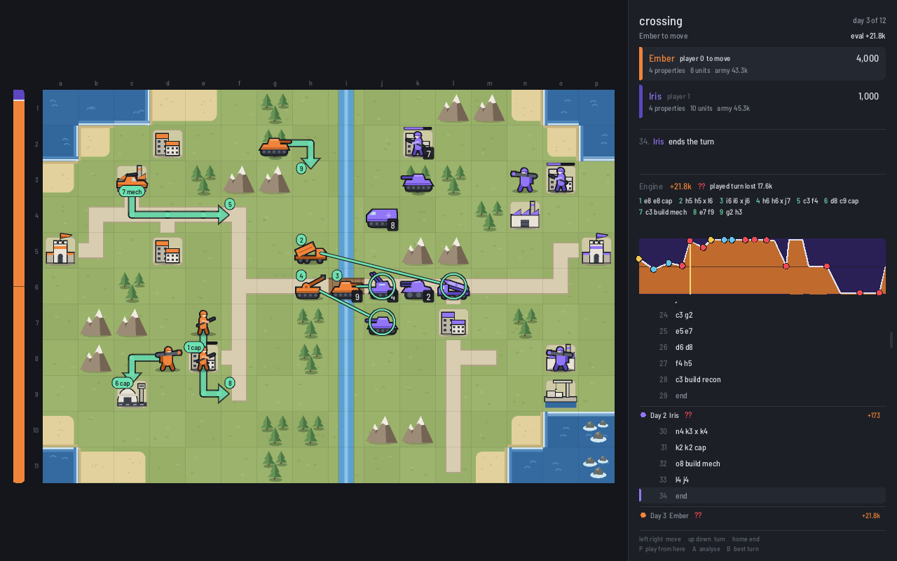
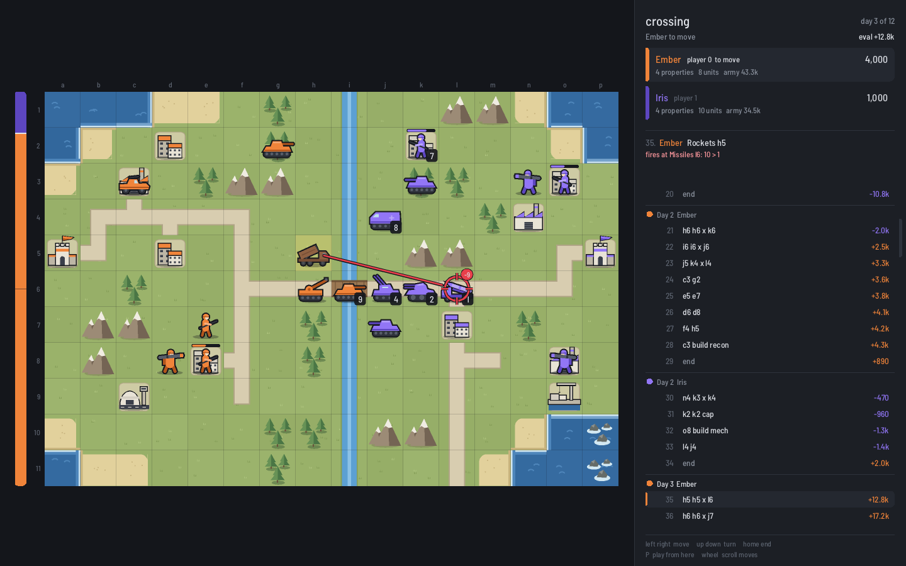

# shoal

An engine for Advance Wars: the aim is Stockfish-strength search for AW2-rules games, and a
native replay viewer that shows where players went wrong, like a lichess analysis board.

A shoal is a school of fish, and a beach tile in AW.

Rules: Advance Wars 2 / AWBW standard, no luck, no COs, no fog (for now). See `docs/rules.md`.

## Build

```
cmake --preset release && cmake --build --preset release
./build/shoal_tests
./build/shoal show maps/tiny/hq5.sexp
./build/shoal perft maps/tiny/hq5.sexp 5
```

## Viewer

`shoal_viewer` (SDL3, built when CMake finds it) replays a game record or opens a map:

```
./build/shoal_viewer games/crossing-greedy.sexp
./build/shoal_viewer maps/small/crossing.sexp --screenshot out.bmp --size 1280x800 --ply 12
```

Left/right step one move, up/down one turn, home/end jump to the ends; click a move in the
list or a point on the eval graph to go there. The bar left of the board and the graph are
player 0's view: from the file's `(analysis ...)` when it has one, else its `(evals ...)`.
Turns the engine disliked carry `?!` (inaccuracy), `?` (mistake) or `??` (blunder) in the move
list and on the graph; at a turn start the engine's best turn is drawn as numbered arrows (`B`
hides them) and written in the panel.

`A` runs the planner on the shown position on a background thread (1.5 s) and shows its score
and best line; it is what makes play mode useful. `P` switches to play mode: click a unit, a
destination, then an action; the moves after the current one are replaced, `R` reloads the
file. `--screenshot` draws one frame with a software renderer and no window
(`--events right,up,click:X:Y,a,...` scripts input first; a live analysis is waited for).

## Analysis

```
./build/shoal analyse games/crossing-greedy.sexp --time 1 --threads 8 --out annotated.sexp
./build/shoal_viewer games/crossing-greedy-analysed.sexp
```

Every turn start is searched (two planner searches of `--time` seconds each, see
`docs/engine.md`); the table shows the score, what each played turn lost against the engine's
best, and the engine's turn next to the one played.



The art is drawn from shapes in code; the font is Barlow Semi Condensed (OFL, `data/fonts`).



## Files

Maps and games are S-expressions (`maps/`, see `docs/formats.md`). Moves are written like
`"b2 c2"` (move and wait), `"b2 c2 x c3"` (move and attack c3), `"b1 b1 cap"`,
`"e5 build inf"` and `"end"`. Tiles are named like chess squares, `a1` top left.

Not affiliated with Nintendo or Intelligent Systems. No game assets are included.
